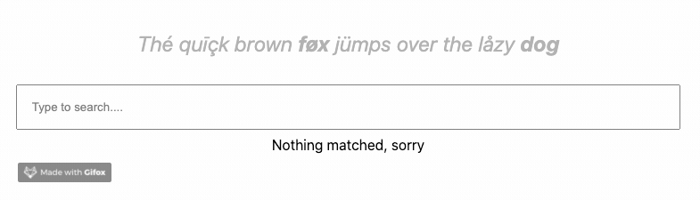

**Lucid** is a stand-alone, zero-dependency, lightweight library that finds literal matches in text and tells you exactly where they are. It is built for AI agents (tool calls get plain JSON with positions) and for search-as-you-type UIs (safe highlighting).

[](https://www.npmjs.com/package/lucid-search)
[](https://github.com/Niekes/lucid-search/blob/master/LICENSE)
[](https://bundlephobia.com/result?p=lucid-search)
[](https://www.npmjs.com/package/lucid-search)

<table>
    <tr>
        <td> <a target="_blank" href="https://codepen.io/niekes/pen/QWGJBKe">  </a> </td>
    </tr>
</table>

# Installing

```bash
npm i lucid-search
```

```html
<script type="module">
    import { search } from 'https://unpkg.com/lucid-search@2/src/index.js';
</script>
```

ES modules only, Node >= 20.19.

# Usage

### `search(haystack, needle, { normalize? })`

```js
import { search } from 'lucid-search';

search('The quick brown fox jumps over the lazy dog', 'The dog barks');
/*
{
    matches: [
        { start: 0, end: 3, text: 'The', term: 'The' },
        { start: 31, end: 34, text: 'the', term: 'The' },
        { start: 40, end: 43, text: 'dog', term: 'dog' },
    ],
    missing: ['barks'],
}
*/
```

* The needle is **literal**: `c++`, `$5` or `(x` match themselves, never as a regex.
* A string needle is split into terms on whitespace, `.`, `-` and `_`. Pass an array (`['new york', 'c++']`) to choose the terms yourself.
* Case-insensitive, matches inside words, sorted by `start`, never overlapping (the longer term wins).
* `missing` lists the terms that occur nowhere, so an agent knows what to rephrase.
* `{ normalize: true }` lets `creme` find `Crème`; positions still point into the original text.
* Wrong input types throw a `TypeError`.

### `highlight(haystack, matches, { el = 'span', cssClass = 'matched' })`

```js
import { search, highlight } from 'lucid-search';

const text = 'The lazy dog';
highlight(text, search(text, 'dog').matches, { el: 'mark' });
// 'The lazy <mark class="matched">dog</mark>'
```

The whole haystack is HTML-escaped, so it is safe to put into `innerHTML`.

### `score(matches, haystack)`

Rank several haystacks for the same needle: longer and earlier matches score higher.

```js
const ranked = docs
    .map(doc => ({ doc, matches: search(doc, needle).matches }))
    .map(r => ({ ...r, score: score(r.matches, r.doc) }))
    .filter(r => r.score > 0)
    .sort((a, b) => b.score - a.score);
```

# Using it from an AI agent

Give the model the text around each match instead of the whole document:

```js
const context = matches.map(m => text.slice(Math.max(0, m.start - 80), m.end + 80));
```

Wrap `search` as a tool (shape shown for the Anthropic Messages API; other frameworks are similar):

```js
const tool = {
    name: 'find_in_text',
    description: 'Find literal, case-insensitive occurrences of search terms in the document. Returns positions, short context, and terms that were not found.',
    input_schema: {
        type: 'object',
        properties: { terms: { type: 'array', items: { type: 'string' } } },
        required: ['terms'],
    },
};

function findInText({ terms }) {
    const { matches, missing } = search(documentText, terms, { normalize: true });
    return {
        missing,
        matches: matches.slice(0, 20).map(m => ({
            ...m,
            context: documentText.slice(Math.max(0, m.start - 80), m.end + 80),
        })),
    };
}
```

See [`llms.txt`](llms.txt) for a compact API reference for coding assistants.

# Upgrading from v1

v1's eight `findMatches*` / `uncoverMatches*` functions are replaced by `search` (+ `highlight` if you rendered `mark`). Needles are no longer regular expressions. See [docs/adr/0001](docs/adr/0001-search-returns-data-for-agent-callers.md).

### Funding
<a href="https://www.buymeacoffee.com/niekes" target="_blank"></a>

### License
[BSD-3-Clause](https://github.com/Niekes/lucid-search/blob/master/LICENSE) © [Stefan Nieke](https://www.niekes.com)
